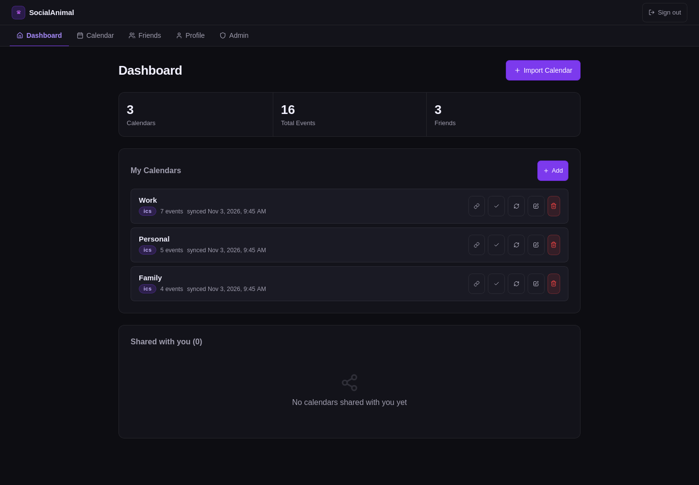
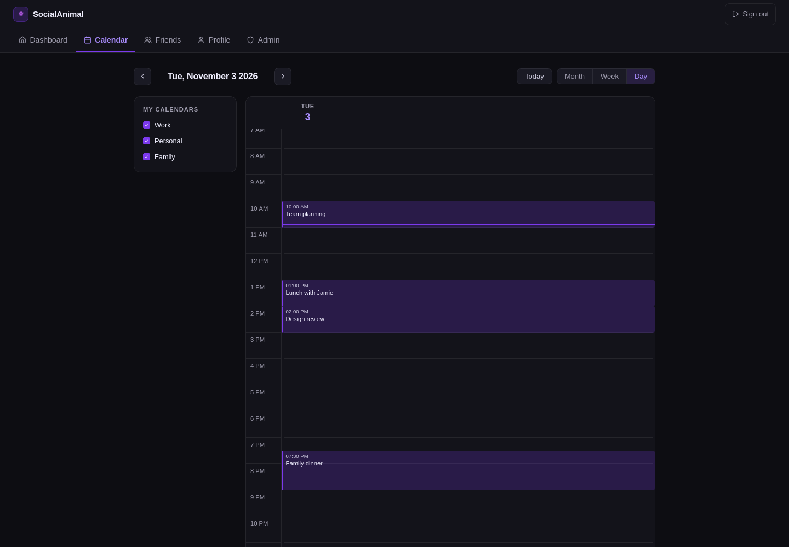
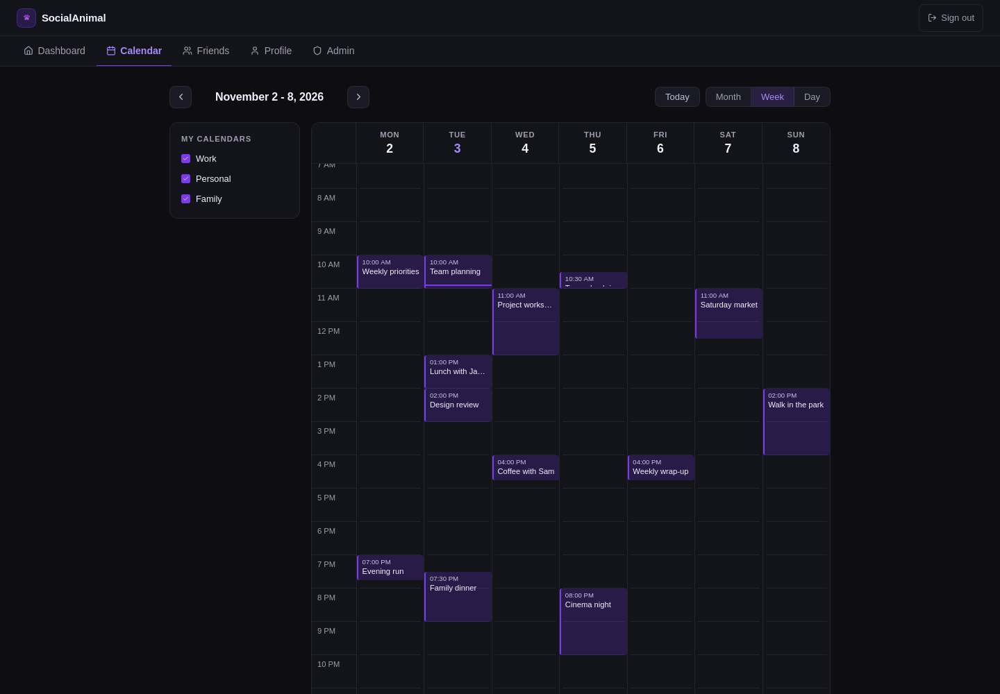
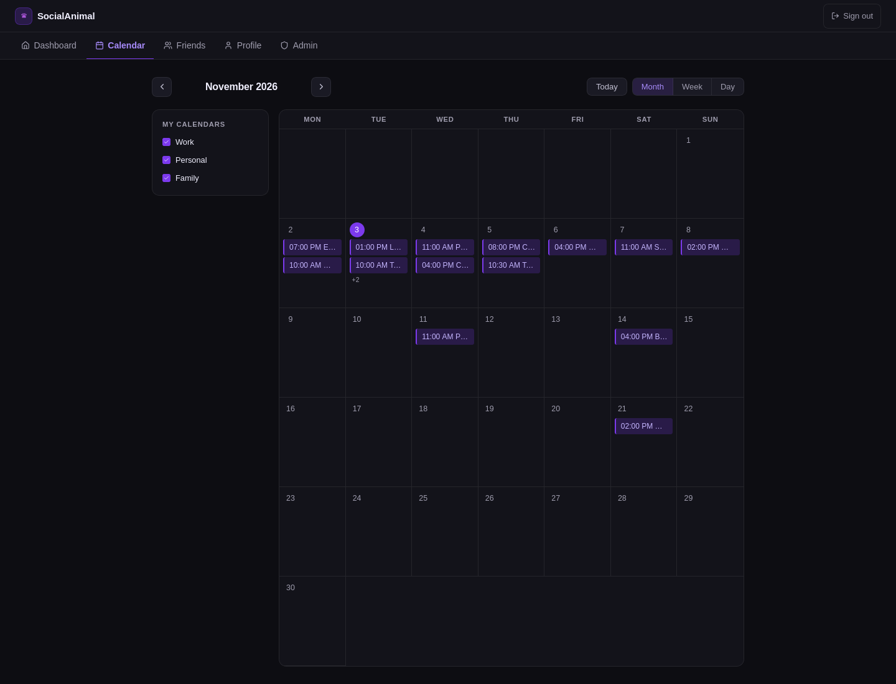
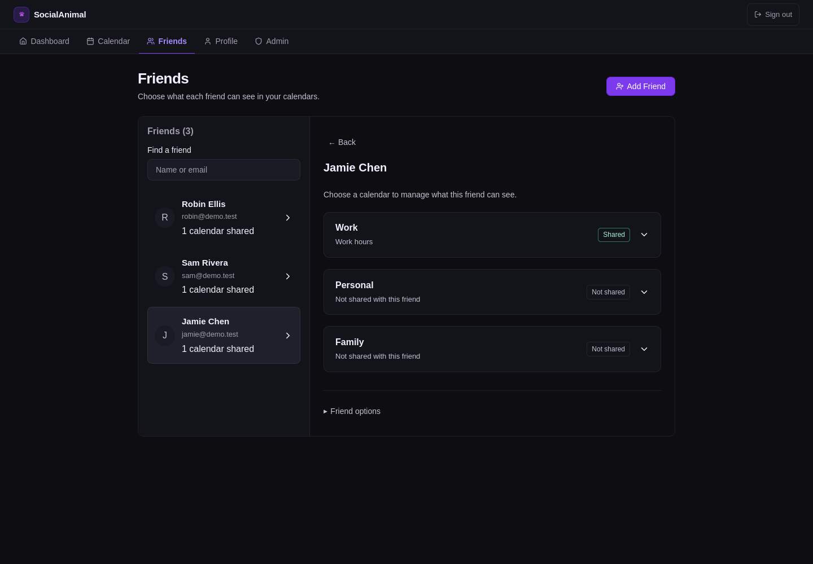
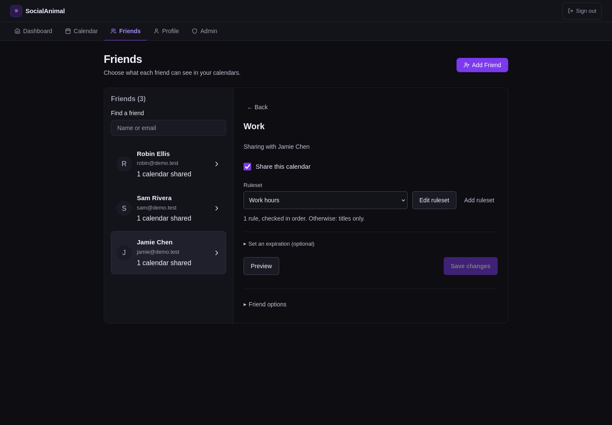
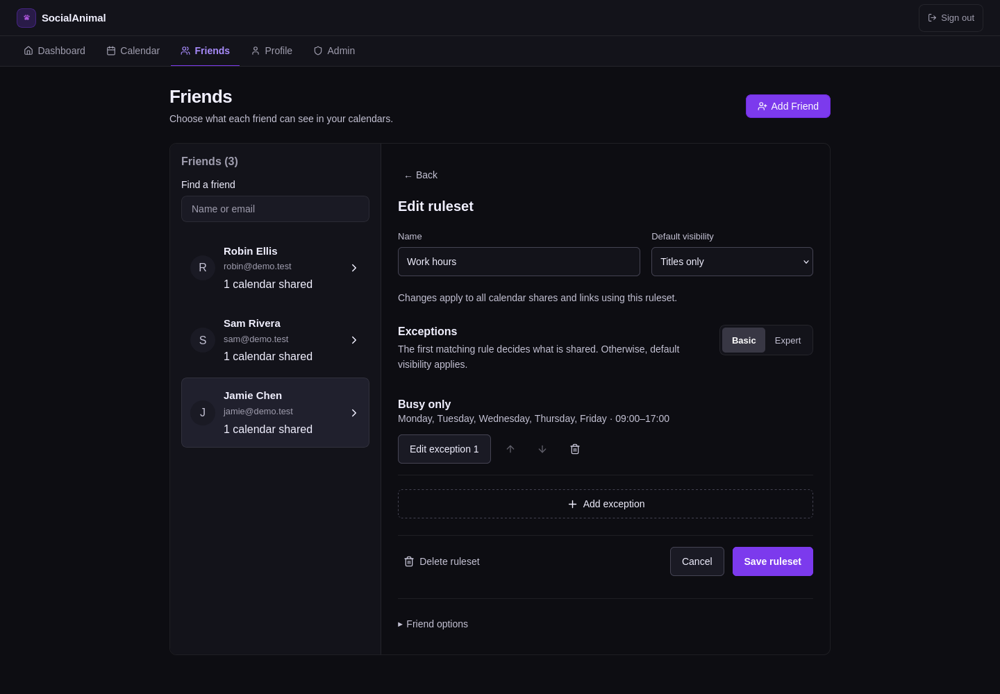
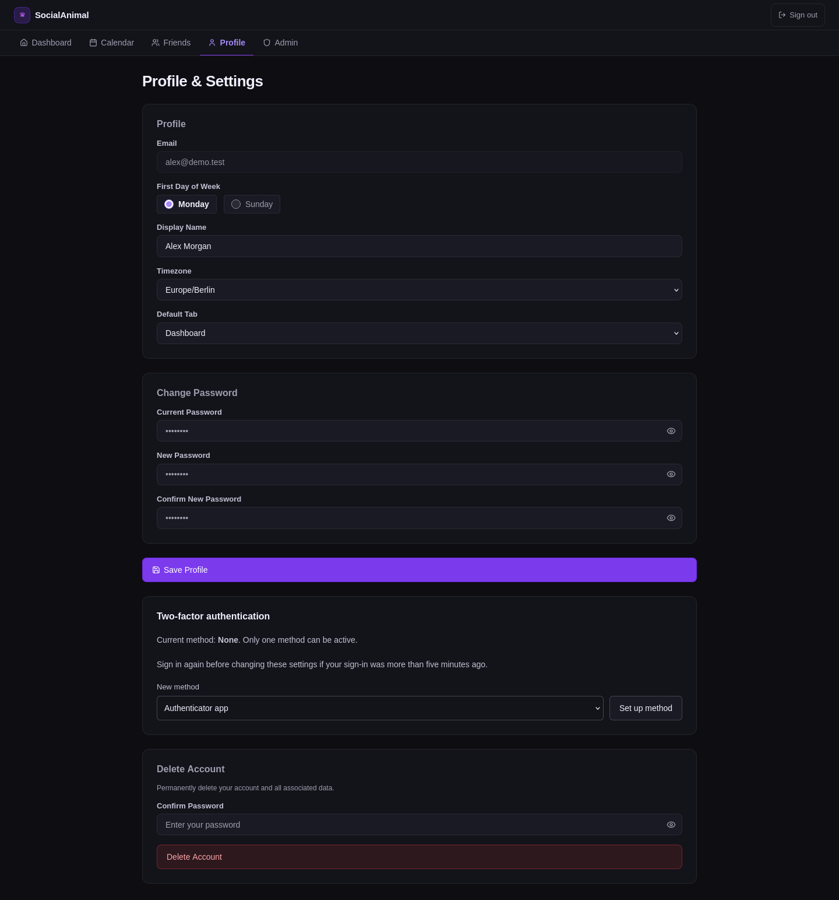
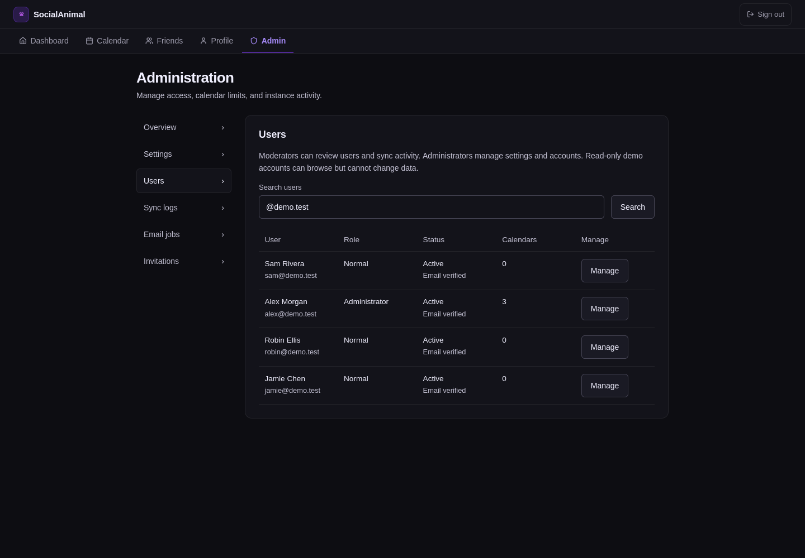

# SocialAnimal 🐾


> Name inspired by _The Social Animal_ by Elliot Aronson - no real psychological correlation, just a fitting name.

SocialAnimal is a **self-hosted social calendar platform** that lets you share your calendar with friends, family, or partners without switching calendar providers.

This is **not** a self-hosted calendar server - tools like [Radicale](https://radicale.org/) already do that job well. Instead, SocialAnimal connects to your existing calendars (Google Calendar, iCloud, CalDAV, or ICS feeds) and lets you decide who can see what.

Friends can view shared events inside SocialAnimal, or subscribe to them from their own calendar app using an ICS link. You can also share calendars through links that don't require an account.

## Try it

A public instance is available at:

https://socialanimal.net

SocialAnimal is still **pre-1.0**. Things may change, and bugs are to be expected. If you're self-hosting, keep backups.

---

## Screenshots

### Dashboard Tab



### Calendar Tab

| Day                          | Week                          | Month                          |
| ---------------------------- | ----------------------------- | ------------------------------ |
|  |  |  |

### Friends Tab

| Friends                 | Sharing Permissions              |
| ----------------------- | -------------------------------- |
|  |  |

### Permission Rules



### Profile Tab



### Admin Tab



---

## Why SocialAnimal?

Most social calendar apps want everyone to use the same platform. But what if you already have your calendars set up and just want to share them with other people?

SocialAnimal sits on top of your existing calendar providers. Keep using your usual calendar app while sharing your schedule with others.

- **Keep your provider:** Import calendars from Google Calendar, iCloud, CalDAV, or an ICS feed.
- **Control what others see:** Share full event details, just titles, or only whether you're busy. You can also hide events and set more specific rules.
- **Share outside the app:** Let people subscribe to a shared calendar through ICS, or create a sharing link for someone without an account.
- **Host it yourself:** Run the app on your own server with Docker.

## Current Features

**Accounts & Social**

- User accounts, profiles, and friend requests
- Admin dashboard for users, registration, invitations, and instance settings
- Email verification, password resets, and sign-in codes (with SMTP configured)
- Authenticator-based two-factor authentication and recovery codes

**Calendar Integration**

- Google Calendar import through OAuth
- iCloud and other CalDAV calendars
- ICS / iCal feed imports
- Automatic calendar synchronization with configurable limits
- ICS links for external calendar clients

**Calendar Experience**

- Day, week, and month views
- View your own and your friends' shared events together
- Toggle individual calendars on and off

**Sharing & Permissions**

- Share individual calendars with friends
- Visibility levels: full details, titles only, busy only, or hidden
- Rules for specific times and events
- Shareable links for people without accounts, with optional expiration and revocation

## Roadmap

SocialAnimal is not at a stable v1.0 release yet. Some ideas for future development include:

- [ ] More calendar integrations, such as Outlook, Proton, or Fastmail
- [ ] Creating and managing events directly in SocialAnimal
- [ ] Finding shared free time between friends
- [ ] More export and calendar-push options
- [ ] Calendar color customization

These are ideas rather than promises or a fixed release schedule. Suggestions and contributions are welcome.

---

## Setup

### Quick Start (Docker)

To run the published version of SocialAnimal, you only need **Docker with the Compose plugin**. No Git checkout or local Node.js installation is required.

Download the Compose file and environment template:

```bash
curl -O https://raw.githubusercontent.com/NLion74/SocialAnimal/refs/heads/main/docker-compose.yml
curl -O https://raw.githubusercontent.com/NLion74/SocialAnimal/refs/heads/main/example.env
cp example.env .env
```

Edit `.env` and set at least:

| Variable                    | Description                                                                 |
| --------------------------- | --------------------------------------------------------------------------- |
| `POSTGRES_PASSWORD`         | Password for the PostgreSQL database                                        |
| `JWT_SECRET`                | Secret for authentication sessions                                          |
| `CREDENTIAL_ENCRYPTION_KEY` | A 64-character hexadecimal key for encrypting saved credentials             |
| `PUBLIC_URL`                | The URL from which users access SocialAnimal (e.g. `http://localhost:3000`) |
| `SOCIALANIMAL_VERSION`      | A [published release tag](https://github.com/NLion74/SocialAnimal/releases) |

Generate separate random values for the database password, JWT secret, and encryption key:

```bash
openssl rand -hex 32
```

Run this command three times. The example `DATABASE_URL` uses `POSTGRES_PASSWORD` automatically; leave the database hostname as `db` when using Docker Compose.

Then start the application:

```bash
docker compose up -d --wait
```

Open http://localhost:3000 (or your configured `PUBLIC_URL`) and register. **The first registered account becomes the administrator.**

From there, add calendars on the dashboard and share them through the Friends section. For iCloud, you'll need an Apple app-specific password; for an ICS feed, just supply its URL.

**Important:** Keep your `.env` file private. When moving or restoring an existing database, keep the database password and `CREDENTIAL_ENCRYPTION_KEY` unchanged, since the encryption key is needed to read saved provider credentials and authenticator secrets. If a password contains `$`, put its value in single quotes so Compose doesn't interpret it as a variable (but leave the example `DATABASE_URL` references unquoted).

For a local source build or live-reload setup, see [Development](#development).

### Environment Variables

Use [example.env](example.env) as the starting point for `.env`, `.env.build`, or `.env.dev`. The full template is included below; replace the blank required secrets and choose your own SMTP server if you enable email.

<details>
<summary>View example.env</summary>

```dotenv
# Production: copy to .env, fill in secrets and a published release tag.
# Build testing: copy to .env.build and use SOCIALANIMAL_VERSION=local.
# Development: copy to .env.dev; dev Compose always runs in development mode.
# Single-quote literal secrets containing $, e.g. SMTP_PASSWORD='your-password'.
SOCIALANIMAL_VERSION=
NODE_ENV=production

# Leave blank to use Compose defaults: verbose in development, production otherwise.
# Both modes write structured JSON to stdout with sensitive data omitted.
# Verbose includes request starts, health checks, job timings and safe error locations.
LOG_MODE=
# Optional override: fatal, error, warn, info, debug, trace, silent.
# Defaults to debug in verbose mode and info in production mode.
LOG_LEVEL=

# Host ports. Containers always use frontend 3000, backend 4000 and PostgreSQL 5432.
# BACKEND_PORT and DB_PORT are exposed only by development Compose.
FRONTEND_PORT=3000
BACKEND_PORT=4000
DB_PORT=5432
PUBLIC_URL=http://localhost:3000

POSTGRES_USER=postgres
POSTGRES_DB=socialanimal
# Generate a password with: openssl rand -hex 32
POSTGRES_PASSWORD=
DATABASE_URL=postgresql://${POSTGRES_USER}:${POSTGRES_PASSWORD}@db:5432/${POSTGRES_DB}

# Generate independently with: openssl rand -hex 32
JWT_SECRET=

# Generate with: openssl rand -hex 32
# Keep this key stable and back it up with the database.
CREDENTIAL_ENCRYPTION_KEY=

# Optional Google integration. Set all three together, or leave them blank.
# The callback must also be registered in Google Cloud:
# https://YOUR_PUBLIC_HOST/api/v1/connections/google/callback
GOOGLE_CLIENT_ID=
GOOGLE_CLIENT_SECRET=
GOOGLE_REDIRECT_URI=

MIN_SYNC_INTERVAL_MINUTES=15
SYNC_CONCURRENCY=3

# Optional exact hostnames/IPs for self-hosted providers on private networks.
# Leave empty to block private network targets. Never use a wildcard.
PRIVATE_PROVIDER_HOSTS=

# Verification email. Configure SMTP before enabling required verification in Admin.
# Port 587 uses STARTTLS; use SMTP_SECURE=true with port 465 for implicit TLS.
SMTP_HOST=mail.nlion.nl
SMTP_PORT=587
SMTP_SECURE=false
SMTP_REQUIRE_TLS=true
SMTP_USER=
SMTP_PASSWORD=
SMTP_FROM=

# Optional comma-separated browser origins; defaults to PUBLIC_URL.
CORS_ORIGINS=
# Only list proxy addresses/subnets you control. Empty means ignore forwarded IPs.
TRUSTED_PROXY_CIDRS=
```

</details>

Every variable in the template is described here. Port values refer to the host; the containers keep their internal ports.

| Variable                    | What it does                                                                                                                                                                                                                      |
| --------------------------- | --------------------------------------------------------------------------------------------------------------------------------------------------------------------------------------------------------------------------------- |
| `SOCIALANIMAL_VERSION`      | Docker image tag for release and build mode. Use a published release tag for release mode, or `local` for a local build. Development uses fixed image names.                                                                      |
| `NODE_ENV`                  | Application runtime mode. Compose sets this to `production` for release/build and `development` for dev, overriding the value in the environment file.                                                                            |
| `LOG_MODE`                  | Logging detail: `verbose` includes request starts, health checks, and job timings; `production` is quieter. Blank uses verbose logging in development and production logging otherwise. Secrets are omitted in both modes.        |
| `LOG_LEVEL`                 | Minimum log severity: `fatal`, `error`, `warn`, `info`, `debug`, `trace`, or `silent`. Blank uses `debug` in verbose mode and `info` in production mode.                                                                          |
| `FRONTEND_PORT`             | Host port for the web interface; defaults to `3000`.                                                                                                                                                                              |
| `BACKEND_PORT`              | Host port for direct backend access in development; defaults to `4000`. Release and build mode do not expose this port.                                                                                                           |
| `DB_PORT`                   | Host port for PostgreSQL access in development; defaults to `5432`. Release and build mode do not expose this port.                                                                                                               |
| `PUBLIC_URL`                | Browser-facing origin, including scheme and any nonstandard port, such as `https://calendar.example.com`. Used for generated links, authentication redirects, and the default allowed browser origin.                             |
| `POSTGRES_USER`             | PostgreSQL user created when initializing the database; defaults to `postgres`. Must match the username in `DATABASE_URL`.                                                                                                        |
| `POSTGRES_DB`               | Database created on first startup; defaults to `socialanimal`. Must match the database name in `DATABASE_URL`.                                                                                                                    |
| `POSTGRES_PASSWORD`         | Password used to initialize the PostgreSQL user. Required even with a literal `DATABASE_URL`; setting it does not change an existing database user's password.                                                                    |
| `DATABASE_URL`              | PostgreSQL connection string used by setup and the backend. The template expands the `POSTGRES_*` values and connects to Compose service `db` on internal port `5432`. URL-encode special characters if writing the URL yourself. |
| `JWT_SECRET`                | Secret used to sign and verify authentication tokens. Generate it independently of the other secrets; changing it invalidates existing tokens.                                                                                    |
| `CREDENTIAL_ENCRYPTION_KEY` | Exactly 64 hexadecimal characters used to encrypt saved provider credentials and authenticator secrets. Keep it stable and back it up with the database; a different key cannot decrypt existing records.                         |
| `GOOGLE_CLIENT_ID`          | OAuth client ID for Google Calendar imports. Optional; configure it together with the other two Google variables.                                                                                                                 |
| `GOOGLE_CLIENT_SECRET`      | Secret belonging to that Google OAuth client. Leave all three Google variables blank if Google imports are not needed.                                                                                                            |
| `GOOGLE_REDIRECT_URI`       | Google OAuth callback URL: `PUBLIC_URL` followed by `/api/v1/connections/google/callback`. It must exactly match an authorized redirect URI in Google Cloud.                                                                      |
| `MIN_SYNC_INTERVAL_MINUTES` | Minimum interval between automatic calendar synchronizations, in minutes; defaults to `15`. Admin can raise the instance minimum above this value.                                                                                |
| `SYNC_CONCURRENCY`          | Maximum number of calendar sync jobs processed concurrently; defaults to `3`, with a supported range of `1`–`16`.                                                                                                                 |
| `PRIVATE_PROVIDER_HOSTS`    | Optional comma-separated exact hostnames or IP addresses allowed for calendar providers on private networks. Blank blocks private network targets; wildcards are not supported.                                                   |
| `SMTP_HOST`                 | SMTP server for account and notification emails. Replace the example host with your mail provider's server; email requires both this value and `SMTP_FROM`.                                                                       |
| `SMTP_PORT`                 | SMTP server port. The template uses `587` for STARTTLS; use `465` with `SMTP_SECURE=true` for TLS from the start.                                                                                                                 |
| `SMTP_SECURE`               | Set to `true` for TLS immediately on connection, usually port `465`. `false` allows the STARTTLS upgrade, usually on port `587`.                                                                                                  |
| `SMTP_REQUIRE_TLS`          | Requires STARTTLS when `SMTP_SECURE=false`; defaults to `true`. Set to `false` only when intentionally using a mail server without required TLS, such as a local test server.                                                     |
| `SMTP_USER`                 | SMTP authentication username. Leave blank if the mail server does not require authentication.                                                                                                                                     |
| `SMTP_PASSWORD`             | SMTP authentication password for `SMTP_USER`.                                                                                                                                                                                     |
| `SMTP_FROM`                 | Sender address for outgoing mail, optionally with a display name such as `SocialAnimal <calendar@example.com>`. Use an address your SMTP server permits.                                                                          |
| `CORS_ORIGINS`              | Optional comma-separated browser origins allowed to call the backend. Blank uses `PUBLIC_URL`.                                                                                                                                    |
| `TRUSTED_PROXY_CIDRS`       | Optional comma-separated proxy addresses or subnets trusted to supply forwarded client IPs. Blank ignores forwarded IPs; include only proxies you control.                                                                        |

### Google Calendar Setup (Optional)

To enable Google Calendar imports:

1. Open [Google Cloud Console](https://console.cloud.google.com/).
2. Create a project (or select an existing one) and enable the **Google Calendar API**.
3. Configure the OAuth consent screen with the `https://www.googleapis.com/auth/calendar.readonly` scope.
4. Create an OAuth client of type **Web Application**.
5. Add an authorized redirect URI, replacing the domain with your own:

    ```text
    https://calendar.example.com/api/v1/connections/google/callback
    ```

6. Add `GOOGLE_CLIENT_ID`, `GOOGLE_CLIENT_SECRET`, and `GOOGLE_REDIRECT_URI` to your environment file, then restart SocialAnimal.

For local installations, the redirect URI can be `http://localhost:3000/api/v1/connections/google/callback`.

Google credentials are **not** needed for iCloud, CalDAV, or ICS imports. If you're connecting to a calendar server on a private network, add its exact hostname or IP to `PRIVATE_PROVIDER_HOSTS`.

### Email & Account Security (Optional)

Configure the `SMTP_*` variables to enable verification emails, password resets, and email sign-in codes.

Port `587` typically uses STARTTLS. For port `465`, set `SMTP_SECURE=true`. Make sure `SMTP_FROM` is an address your mail server accepts.

Before requiring email verification or two-factor authentication in the admin settings, test mail delivery. You can check failed or successful delivery attempts in the admin email job log. Users can also set up an authenticator app and recovery codes from their profile.

### Hosting on a Domain

Put SocialAnimal behind an HTTPS reverse proxy and set `PUBLIC_URL` to the public address. The release and build configurations expose only the frontend, on host port `3000` by default. You can change this using `FRONTEND_PORT`.

If you need forwarded client IP addresses for rate limiting, set `TRUSTED_PROXY_CIDRS` to **only** the addresses or subnets of proxies you control. Avoid logging query strings or private sharing-link tokens in your reverse proxy access logs.

---

## Development

Contributions are welcome! If you're planning a larger architectural change, please open an issue first so it can be discussed. For smaller fixes, feel free to open a pull request directly.

Unlike the Docker-only [Quick Start](#quick-start-docker), development requires the source code. Clone the repository:

```bash
git clone https://github.com/NLion74/SocialAnimal.git
cd SocialAnimal
```

### Run with live reload

Create a development environment file from the template and update the values described in [Quick Start](#quick-start-docker):

```bash
cp example.env .env.dev
docker compose --env-file .env.dev -f dev-docker-compose.yml up --wait
```

This uses the development Compose configuration for editing the application with live reload.

### Test a production build locally

To build production images from your current checkout instead of pulling a published release:

```bash
cp example.env .env.build
# Set SOCIALANIMAL_VERSION=local in .env.build
docker compose --env-file .env.build -f build-docker-compose.yml up -d --build --wait
```

Use one mode at a time. Each Compose service reads its corresponding environment file, but the matching `--env-file` flag is still needed for Compose variable interpolation. If PostgreSQL reports a missing superuser password, verify `POSTGRES_PASSWORD` and `DATABASE_URL` rather than deleting your database directory.

### Tech Stack

- **Frontend:** Next.js, React, TypeScript
- **Backend:** Node.js, Fastify, TypeScript
- **Database:** PostgreSQL
- **ORM:** Prisma
- **Testing:** Vitest
- **Containerization:** Docker and Docker Compose

### Running Tests

```bash
cd backend
npm test

cd ../frontend
npm test
```
