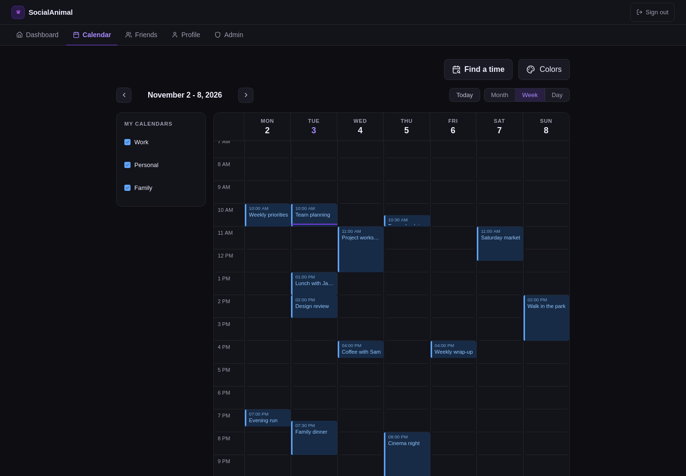
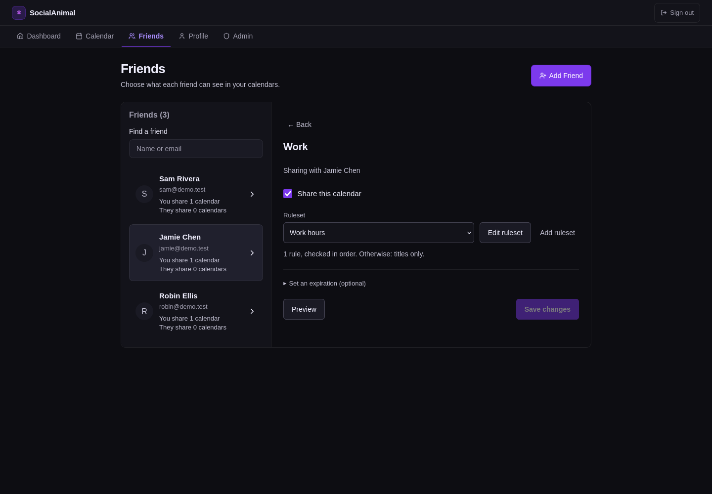
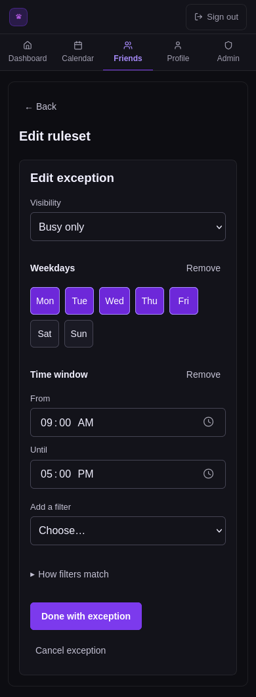
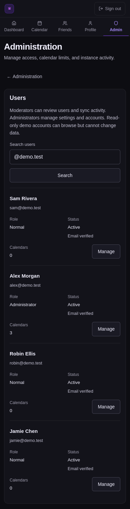

# Frontend review — 9 November 2026

Review only; no product UI changes were made for this task. Preserve the dark surfaces, purple accent, compact calendar, and existing typography. The proposals below require no new gradients.

## Prioritized proposals

| Priority | Evidence | Proposal and acceptance check |
| --- | --- | --- |
| P1 | `frontend/features/calendars/CalendarView.tsx:256`, `:540`, `:643`, `:657` — event pills are clickable spans; day cells are clickable divs without keyboard support. This also affects the public calendar. | Use buttons for events and a separate day-opening control, with names including title/date/time. Provide arrow-key day navigation and a visible focus state. Verify that a keyboard-only user can open and close event details in day/week/month views and return to the triggering event. |
| P1 | `frontend/features/account/api.ts:47`, `frontend/features/account/Profile.tsx:114` — one save runs name, preferences, then password requests. A later failure can leave earlier changes saved while the UI reports that profile changes could not be saved. | Separate profile/preferences and password forms with independent pending/success/error states; either make related profile writes atomic or explicitly report partial success. Test a successful name update followed by a failed preference/password request. Keep notification preferences' existing separate save. |
| P1 | `frontend/features/account/Profile.tsx:379`, `frontend/features/friends/Friends.tsx:173` — read-only users see the browsing-only notice but still see enabled edit/save/add actions. The mobile screenshot below confirms the enabled profile-save button. | Render unavailable mutations disabled with an adjacent explanation, consistently across profile, friends, calendars and security. Keep readable content accessible. Backend rejection is already enforced; the proposal improves the UI's promise. |
| P2 | `frontend/features/account/Login.tsx:102`, `:119`; `frontend/features/account/Register.tsx:126`, `:140` — primary authentication fields lack explicit autocomplete/name hints. | Add `email`/`username`, `current-password`, `new-password`, and `name` hints as appropriate, disable email spellchecking, link field errors, and focus the first invalid field. Retain password reveal, paste support and existing one-time-code autocomplete. Verify Firefox autofill and keyboard submission. |
| P2 | `frontend/features/permissions/CalendarShareRow.tsx:173`, `frontend/features/permissions/ShareRules.tsx:293` — “Ruleset”, “fallback” and ordered-rule explanations remain technical in the common sharing path. | Use “What Jamie can see”, “Sharing rules” and “Otherwise show …”; retain expert terminology in the expert editor. Keep explicit Save and saved-versus-draft preview wording. The existing per-calendar success feedback is accurate and should remain. |
| P2 | `frontend/features/friends/Friends.tsx:240`, `:387` — a friend row and chevron open sharing; removal is inside the selected detail view. | Add a visible “Manage sharing” action or label in the row, and a consistently placed overflow action for removal. Preserve the current explicit Accept/Decline/Cancel request controls and removal confirmation. Test with touch and keyboard, without relying on hover. |
| P2 | `frontend/features/permissions/ConditionEditor.tsx:59`, `frontend/features/permissions/BasicRuleEditor.tsx` — the basic editor is substantially clearer, while advanced nested all/any/not groups still require careful reading. | Keep Basic as the default. Give each advanced group a short sentence summary, visibly bounded child groups and a local add/remove affordance; show “All of these”, “Any of these”, and “Except when”. Test nested groups at 390px and 320px, including focus after removal. |
| P2 | `frontend/features/admin/Admin.module.css:394`, `frontend/features/admin/Admin.tsx:249` — desktop section navigation is persistent; mobile replaces it with a detail view and a back button. | Preserve the working desktop sidebar. On mobile retain the selected section name and a compact section switcher while scrolling long user/settings lists. Put section selection in the URL so refresh/back restores it. Global Admin navigation already stays available and needs no redesign. |
| P2 | `frontend/features/calendars/Calendar.tsx:51`, `:94`, `frontend/features/friends/Friends.tsx:142`, `frontend/app/(protected)/layout.tsx:54` — calendar loads are all-or-nothing and clear prior events on failure; some loading containers lack status semantics. | Keep the last successful view with a stale-data notice and an explicit retry. Distinguish “no events”, “no calendars selected”, “not shared”, and “could not load”. Apply the existing Feedback alert/status component and loading announcements consistently. |

## Firefox coverage and limits

The existing 12 active end-to-end scenarios passed against production-built frontend code and a disposable migrated PostgreSQL database. They cover login/registration, recovery and verification, account settings and deletion, authenticator/email/recovery codes, calendar day/week/month and details, connections/import/sync feedback, friend sharing, basic/expert rules and preview, sharing-link creation and public views, invitations, administrator user/security/email actions, availability, colors and notifications. The screenshot scenario and additional route/role review also passed separately.

The extra opt-in review visited `/dashboard`, `/calendar`, `/friends`, `/profile`, and `/admin` as normal, administrator, moderator and read-only users at 1440px and 390px. It checked denied administration for normal/read-only users and denied login for a disabled account. Anonymous coverage included `/`, `/login`, `/register`, `/forgot-password`, `/reset-password`, `/verify-email`, and `/shared`; valid token flows are covered by the existing tests. No horizontal page overflow was measured in the 40 authenticated route/viewport combinations. Basic rule and administrator captures also cover 320px and 768px.

This is a source and Firefox interaction review, not a screen-reader audit. External provider authorization screens and real email delivery were not visually reviewed; tests use local fixtures. Non-page routes (`/config`, API proxy, OAuth callback and feed download) are exercised as service flows, not visual pages.

The shared native-dialog component already supplies accessible names, Escape handling, modal focus containment and focus restoration (`frontend/components/Modal.tsx:27`). Preserve those behaviors. Existing feedback tests already distinguish mutation success from a subsequent refresh failure in several admin/sharing flows; profile saving remains the concrete partial-success gap above.

Guidance: [Web Interface Guidelines](https://raw.githubusercontent.com/vercel-labs/web-interface-guidelines/main/command.md), supplemented by the repository UI/UX skill's keyboard-focus guidance. Findings come from the current source and the captures below.

## Representative captures

All accounts, events and credentials used in these captures are fictional. These are current-state evidence, not proposed redesign mockups.

| Desktop | Mobile |
| --- | --- |
| [Calendar](calendar-desktop.png) | [Basic rule editor](rules-mobile.png) |
| [Sharing](sharing-desktop.png) | [Administrator users](admin-mobile.png) |
| [Profile](profile-desktop.png) | [Read-only profile](readonly-profile-mobile.png) |









## Reproduce

Initialize an empty disposable `*_test` database using the backend setup entrypoint. From `frontend`, use the same `TEST_DATABASE_URL` and run:

```sh
PLAYWRIGHT_PRODUCTION=1 npm run test:e2e
PLAYWRIGHT_PRODUCTION=1 README_SCREENSHOTS=1 npx playwright test readme-screenshots.spec.ts
PLAYWRIGHT_PRODUCTION=1 UI_REVIEW=1 npx playwright test ui-review.spec.ts
```

The screenshot tools write fictional-data artifacts to `/tmp/socialanimal-readme` and `/tmp/socialanimal-ui-review`. The role sweep writes its coverage/overflow results there as JSON. Production database values are never used in this review.
